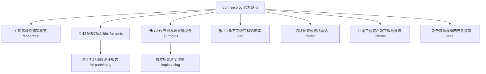

<div align="center">

# 🌐 VPN免费 (vpnfree.blog)
### 2026 翻墙机场与网络代理独立可观测性评测平台 · 42 家品牌晚高峰测速实验室

[](https://astro.build/)
[](https://tailwindcss.com/)
[](https://www.typescriptlang.org/)
[](https://vpnfree.blog/)
[](./LICENSE)

<p align="center">
  <a href="https://vpnfree.blog">官方网站</a> •
  <a href="https://vpnfree.blog/airports">42 家机场品牌库</a> •
  <a href="https://vpnfree.blog/speedtest">测速实验室</a> •
  <a href="https://vpnfree.blog/topics">GEO 专线选型全书</a> •
  <a href="https://vpnfree.blog/faq">80 条百科 FAQ</a> •
  <a href="https://vpnfree.blog/radar">避坑雷达</a>
</p>

</div>

---

## 📖 项目愿景与使命 (Vision & Mission)

市面上的科学上网与“机场评测”充斥着拿钱吹捧、虚标 IEPL 专线、伪造测速图以及无休止的“年付跑路”陷阱。

**VPN免费 (`vpnfree.blog`)** 是由网络工程师、跨境科研人员与出海开发者联合打造的**独立网络性能可观测性平台**。我们秉承四大铁律：
1. **实测截图为证**：拒绝空口无凭，全部以晚高峰 20:00-23:00、电信/联通/移动真实千兆宽带探针下的 `MAI-TEST-BOT` 原始测速截图为依据。
2. **拒绝利益裹挟**：公网中转冒充专线直接曝光，超售卡顿直接标注，客观公开真实丢包与延迟数据。
3. **安全避坑为首**：坚守“月付保平安”底线，设立行业首个跑路风险与超售避坑雷达。
4. **场景精准匹配**：不推最贵的，只推最对的。针对 OpenAI/Claude 原生住宅防封控、Netflix/Disney+ 4K 影音、外贸防关联、外服电竞进行 GEO 专项细分。

---

## ✨ 核心功能与内容矩阵 (Feature Matrix)



### 1. 🏢 42 家机场全维度数据库 (`/airports`)
- 覆盖行业主流 42 家知名与黑马机场（光速云、暮光加速、飞猫云、微风网络、大佬云、星岛梦、二猫云、无忧链接、唯兔云等）。
- 详尽标注：起步预算、月付/季付/年付价格、节点倍率、在线设备限制、网络架构（直连 / 公网中继 / IEPL / IPLC）、传输协议（Shadowsocks / Trojan / VLESS-Reality）、官方专属优惠码与直达通道。

### 2. ⚡ 晚高峰测速与解锁大图实验室 (`/speedtest`)
- 收录 17+ 家重点品牌的晚高峰实测大图（原图尺寸、节点 RTT 延迟、单/多线程峰值速率、丢包率一览无余）。
- 集成高清图片灯箱放大组件，支持多维度图集浏览。

### 3. 🌍 GEO 专线与网络场景选型全书 (`/topics`)
- 1.5 万字专著级行业选型专著：
  - **香港超低延迟 20ms 专线**：网页极速直达、跨境办公与游戏加速首选。
  - **ChatGPT & Claude 原生住宅 IP 解锁**：纯净机房/住宅中继，杜绝 `Unable to load site` 与 403 封控。
  - **Netflix 4K / Disney+ / YouTube 全球版权解锁**：彻底告别“仅能看自制剧”降级窘境。
  - **¥5.6 ~ ¥8 平价学生党与轻量备用精选**：超高性价比抗风险方案。
  - **跨境外服电竞（Full Cone NAT 4 / 低抖动）** 与 **跨境电商外贸店铺防封防关联策略**。

### 4. 📚 翻墙与网络代理 80 条万字百科知识库 (`/faq`)
- 专为中文互联网打造的科学上网百科全书，涵盖 8 大核心专业维度：
  - **维度一**：基础概念与行业黑话（机场 vs VPN、按量计费、超售内幕）
  - **维度二**：物理专线与网络架构（IEPL / IPLC / BGP 入口 / 骨干网 QoS）
  - **维度三**：现代代理协议与加密（Shadowsocks 2022、VLESS-Reality、Trojan、Hysteria 2、TUIC）
  - **维度四**：全球地域出口与 GEO 选型（香港、日本软银/IIJ、新加坡、美国住宅）
  - **维度五**：流媒体与多国版权解锁（原生 IP vs DNS 解锁、Netflix 判定机制）
  - **维度六**：AI 大模型风控与反封号（OpenAI 封禁 IP 逻辑、Claude 3.5 封号防范）
  - **维度七**：客户端选型、分流与软路由（Clash Verge Rev、Sing-box、Surge、TUN 虚拟网卡）
  - **维度八**：外贸业务、外服游戏与防跑路资金安全（月付法则、退款争议、防关联）
- 配备即时关键词检索与分类动态筛选。

### 5. 🚨 避坑雷达与跑路防范专区 (`/radar`)
- 建立机场生命周期与风险评级模型（青铜 / 白银 / 黄金 / 殿堂）。
- 梳理 6 大致命跑路前兆（打折促销年付 3 折、频繁更换入口、客服失联、Telegram 禁言、节点大面积标红）。

### 6. 📱 全平台客户端中心 (`/clients`)
- 汇总 Windows、macOS、iOS、Android、Linux 及 OpenWrt 软路由的最佳客户端下载、分流规则配置与订阅转换注意事项。

---

## 🛠️ 技术架构与工程化亮点 (Tech Stack & SEO Engineering)

本项目针对 **Technical SEO** 与 **GEO (Generative Engine Optimization，生成式 AI 引擎优化)** 进行了极致的代码级优化：

| 维度 | 实施方案 | 达成效果 |
| :--- | :--- | :--- |
| **渲染模式** | Astro v7.3 纯静态生成 (SSG) | 0.1s 极速首屏，爬虫无需执行复杂 JS 即可抓取完整正文 |
| **样式体系** | Tailwind CSS v4 现代无运行时 CSS 引擎 | 超轻体积，无阻塞渲染，完美支持明暗双主题无缝切换 |
| **Canonical** | 100% 绝对地址自引用 (`https://vpnfree.blog`) | 彻底杜绝协议、大小写、临时域名造成的重复内容降权 |
| **Sitemap** | 双格式自动构建镜像 (`sitemap-index.xml` + `sitemap.xml`) | 完美兼顾 Google 与百度/神马对不同站点地图格式的解析偏好 |
| **Robots** | 精准放行主流爬虫 (`Googlebot`, `bingbot`, `Baiduspider`, `yisouspider`) | 屏蔽 `/go/` 商业跳转中转，防止爬虫抓取配额浪费与连坐风险 |
| **Schema.org** | 规范化注入 `WebSite`, `Organization`, `BreadcrumbList`, `Product/Offer`, `FAQPage`, `Article` | **100% 剥离假评分**，通过 Google Rich Results 验证，无处罚隐患 |
| **站长平台验证** | 预留 Google、Bing、神马、百度站长平台 Meta 源码直出插槽 | 填入 Token 即可零延迟生效，无需客户端脚本动态注入 |
| **图片与可访问性** | 全站 413 张图片 100% 具备描述性 `alt`，全面开启 lazyload 与宽高属性 | 消除图片裂图，通过 Google Web Vitals 严苛检验 |

---

## 📂 项目目录结构 (Directory Tree)

```text
vpnfree.blog/
├── public/                       # 静态资源与爬虫入口
│   ├── favicon.svg               # 站点矢量 Favicon
│   ├── manifest.webmanifest      # PWA 清单
│   ├── robots.txt                # 搜索引擎抓取控制协议
│   ├── logo/                     # 品牌深/浅色矢量 Logo
│   └── speedtests/               # 42 家机场 MAI-TEST-BOT 原始测速大图
├── scripts/                      # 自动化工程化与 SEO 校验脚本
│   ├── audit-full-seo-infrastructure.cjs  # 全站拉网式 Technical SEO 验收
│   ├── check-internal-links.cjs           # 0 内部死链自动化排查
│   ├── audit-images.cjs                   # 全站图片 alt 完整度检测
│   ├── audit-schemas.cjs                  # Schema 结构化数据真伪复核
│   └── sync-sitemap.cjs                   # sitemap.xml 自动同步生成
├── src/
│   ├── constants/                # 全局常量、导航结构与站长验证配置
│   ├── data/                     # 核心数据仓库
│   │   ├── airports.ts           # 42 家机场评测、测速、资费与协议数据库
│   │   ├── faq-database.ts       # 80 条万字级专著百科 FAQ 数据源
│   │   ├── topics.ts             # GEO 专线场景矩阵数据
│   │   ├── radar-airports.ts     # 避坑雷达评级数据
│   │   ├── clients.ts            # 客户端下载与配置数据
│   │   └── free-resources.ts     # 免费资源与应急节点数据
│   ├── layouts/
│   │   └── Layout.astro          # 全站统一 SEO Head、自适应导航与夜间模式框架
│   └── pages/                    # Astro 页面路由 (全小写英文语义化 URL)
│       ├── index.astro           # 首页 (排行榜与核心入口)
│       ├── airports/             # 42 家机场库与单独详情页 /airports/:slug
│       ├── speedtest.astro       # 测速实验室
│       ├── topics/               # GEO 场景全书与独立专题 /topics/:slug
│       ├── faq.astro             # 80 条万字百科知识库
│       ├── radar.astro           # 避坑雷达
│       ├── clients.astro         # 客户端下载大全
│       ├── free.astro            # 免费资源与应急指南
│       ├── go/[slug].astro       # 商业跳转保护页 (noindex, 0 秒重定向)
│       └── 404.astro             # 优雅自定义 404 页面
├── astro.config.mjs              # Astro 核心配置 (Sitemap 过滤器与 Tailwind 集成)
├── package.json
└── README.md
```

---

## 🚀 本地开发与构建指南 (Getting Started)

### 1. 环境准备
- 推荐使用 Node.js `v20.0.0` 或更高版本。
- 包管理器推荐使用 `npm`。

### 2. 克隆项目与安装依赖
```bash
# 克隆代码仓库
git clone https://github.com/sksksk98698-source/vpnfree.blog.git
cd vpnfree.blog

# 安装项目依赖
npm install
```

### 3. 启动本地开发服务器
```bash
npm run dev
```
启动后访问 `http://localhost:4330/` 即可实时查看预览。

### 4. 执行生产打包与自动化校验
```bash
# 执行 Astro 静态编译并自动同步生成双 Sitemap
npm run build
```
编译产物将生成在 `dist/` 目录中，共计输出 102 个页面，构建耗时仅需 ~1 秒。

### 5. 本地预览生产构建
```bash
npm run preview
```

---

## 🔍 工程化测试与 SEO 自检脚本

项目内置了多项自动化测试脚本，可在部署前验证站点质量：

```bash
# 1. 检查全站内部链接，确保 0 死链
node scripts/check-internal-links.cjs

# 2. 检查全站图片，确保 0 缺失 Alt 标签
node scripts/audit-images.cjs

# 3. 检查全站 JSON-LD 结构化数据，确保 Schema 格式合规
node scripts/audit-schemas.cjs

# 4. 执行全站拉网式 Technical SEO 验收（Title/Description/Canonical/Robots/Sitemap）
node scripts/audit-full-seo-infrastructure.cjs
```

---

## ☁️ 生产环境部署建议 (Deployment)

### 推荐：Cloudflare Pages
1. 在 Cloudflare 控制台中连接 GitHub 仓库 `sksksk98698-source/vpnfree.blog`。
2. 构建设置配置如下：
   - **Framework preset**: `Astro`
   - **Build command**: `npm run build`
   - **Build output directory**: `dist`
   - **Environment variables**:
     - `NODE_VERSION`: `22`
3. 绑定自定义主域名 `vpnfree.blog`。
4. 在 Cloudflare 的 **Rules -> Redirect Rules** 中添加单向 301 规则：
   - 将 `https://www.vpnfree.blog/*` 永久重定向至 `https://vpnfree.blog/$1`。

---

## ⚖️ 免责声明与合规说明 (Disclaimer)

1. **测试数据局限性**：本站展示的测速图与解锁数据仅代表测试探针在特定网络环境（中国电信/联通 1000M FTTH）及特定时段下的瞬时表现。不同地域、不同运营商的路由策略可能存在差异，最终体验请以用户本地实测为准。
2. **合规使用声明**：本站所有技术解析、代理协议对比及网络测速仅供跨境学术科研、出海电商、跨境贸易及软件开发技术交流使用。严禁将相关技术用于任何违反所在国家与地区法律法规的行为。
3. **资金安全提示**：网络服务商具备天然经营周期，本站强烈建议所有用户恪守“**月付保平安**”原则，避免因大额年付造成不可挽回的资金损失。

---

## 📄 授权协议 (License)

本项目采用 [MIT 许可证](./LICENSE) 开源。

Copyright © 2026 [VPN免费 (vpnfree.blog)](https://vpnfree.blog). All Rights Reserved.
